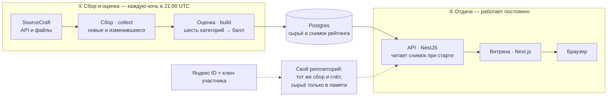
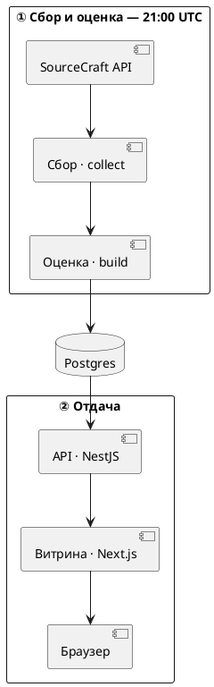

# Проба диаграмм

Три варианта одной схемы repo-vitals: какой из них площадка нарисует.

## 1. Mermaid



## 2. PlantUML



## 3. Псевдографика (для сравнения)

```
 SourceCraft ──▶ collect ──▶ build ──▶ Postgres ──▶ API ──▶ Витрина ──▶ Браузер
```
